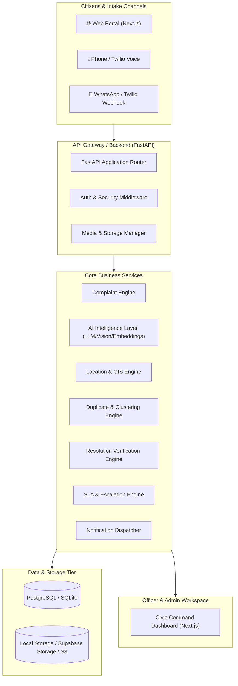
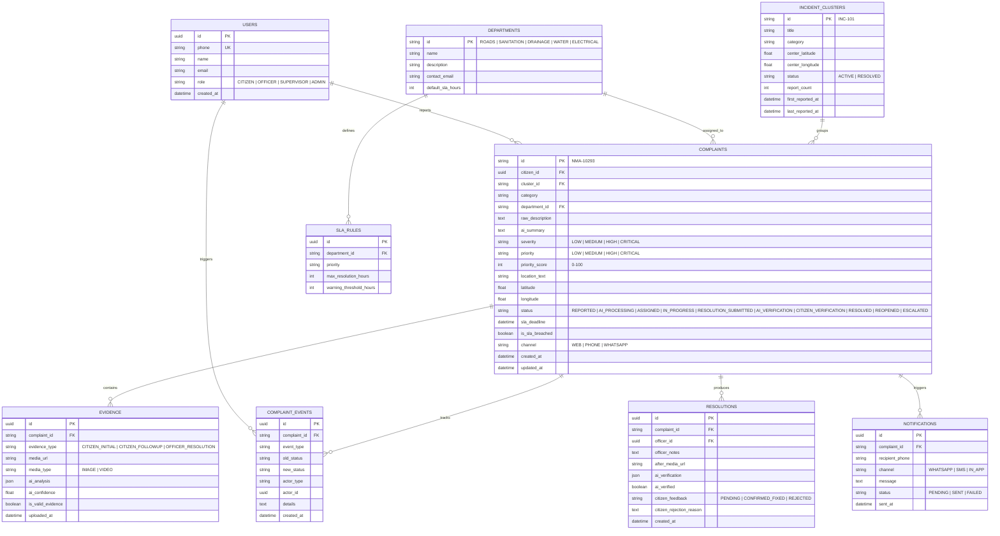
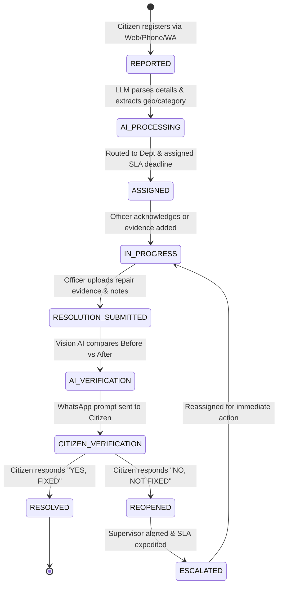
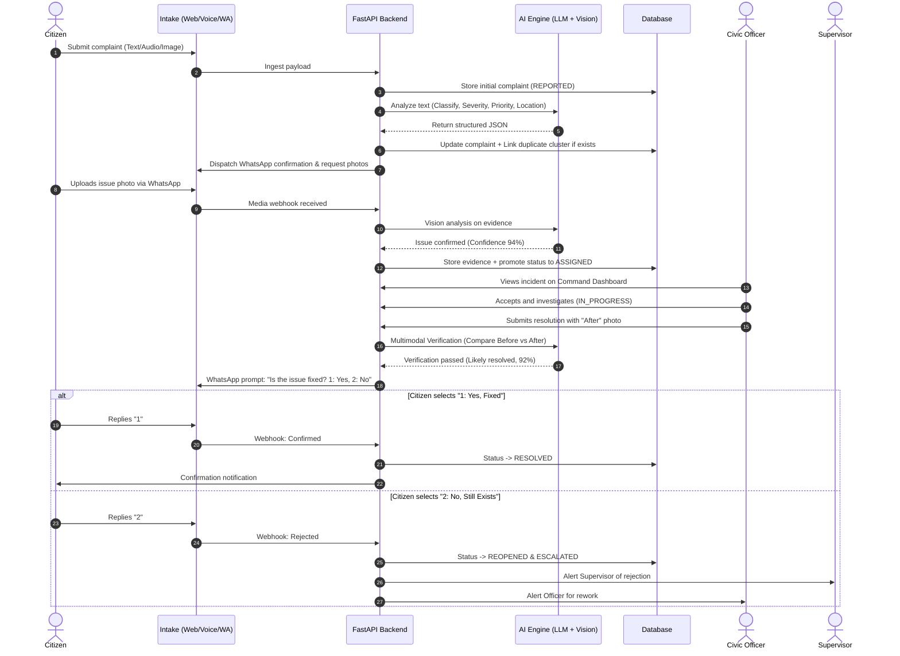

# Namma AI — System Architecture Specification

## 1. Executive Summary

**Namma AI** ("Our AI") is a multimodal civic grievance and outcome-verification platform designed for urban civic bodies. It enables citizens to register complaints effortlessly through Web, Voice (Phone Call), and WhatsApp. It utilizes advanced AI for natural-language understanding, category classification, geocoding, severity and priority estimation, multimodal evidence verification, duplicate detection and incident clustering, officer dispatch, resolution verification, and closed-loop citizen verification.

---

## 2. System Architecture Overview

The system follows a modular, monolithic architecture with distinct service boundaries to ensure operational simplicity, rapid iteration, and maintainability.

---

## 3. Component Responsibilities

| Component | Responsibility |
|---|---|
| **Frontend (`/frontend`)** | Next.js 14 App Router, TypeScript, Tailwind CSS. Provides citizen complaint intake form, real-time tracking, interactive map view, and the Officer Command Dashboard. |
| **Backend API (`/backend/api`)** | FastAPI REST endpoints and webhook listeners for Twilio Voice and WhatsApp. Validates incoming requests and coordinates application workflows. |
| **AI Service (`/backend/services/ai`)** | Isolated abstraction layer over LLMs (Gemini / OpenAI / Mock). Responsible for structured text understanding, category routing, severity/priority scoring, and missing information detection. |
| **Vision AI (`/backend/services/ai/vision.py`)** | Multimodal image analysis to detect defects (potholes, garbage, water leaks, etc.), measure confidence, assess severity, and perform Before/After resolution verification. |
| **Clustering Engine (`/backend/services/clustering.py`)** | Geospatial-temporal semantic clustering that groups related complaints into single actionable incidents (e.g. `INC-102`), aggregating affected citizens. |
| **Resolution Engine (`/backend/services/resolution.py`)** | Manages officer resolution submissions, AI proof verification, citizen verification triggers, and automatic reopening logic. |
| **SLA & Escalation Engine (`/backend/services/sla.py`)** | Monitors deadlines based on priority/category, generates warnings, flags breaches, and escalates cases to supervisors. |
| **Notification Engine (`/backend/services/notifications.py`)** | Dispatches SMS, WhatsApp, and in-app updates to citizens and officers at each stage of the lifecycle. |
| **Database & ORM (`/backend/models`)** | SQLAlchemy ORM models with SQLite (zero-config local run) and PostgreSQL/Supabase production support. |

---

## 4. Database Architecture & Schema

The relational schema ensures data integrity, auditability, and fast geospatial indexing.

---

## 5. Complaint State Progression

The complaint lifecycle follows strict deterministic transitions. AI assists but never transitions states unilaterally without backend validation.

---

## 6. End-to-End Data & Communication Flow

---

## 7. Storage & Security Architecture

1. **Storage Subsystem:**
   - Modular storage provider interface (`LocalStorageProvider`, `SupabaseStorageProvider`, `S3StorageProvider`).
   - Content-type validation (JPEG, PNG, MP4, WebM only) and strict file size limits (max 10MB per image, 25MB per video).
   - Media references stored as unique sanitized paths, avoiding public disclosure of filesystem structures.

2. **Security & Authentication:**
   - Role-Based Access Control (RBAC): `CITIZEN`, `OFFICER`, `SUPERVISOR`, `ADMIN`.
   - Officer endpoints protected by JWT bearer authentication.
   - Twilio Webhook signature validation to prevent spoofing.
   - PII protection: Citizen phone numbers masked in general public dashboards, visible only to authorized investigating officers.
   - Strict output sanitation of AI responses to prevent prompt injection or unstructured garbage injection into SQL queries.

---

## 8. Graceful Degradation Strategy

The platform maintains absolute reliability even during external API downtime:
- **LLM Outage:** Complaints fall back to deterministic keyword matching or enter `MANUAL_REVIEW` status. Complaints are never dropped.
- **Vision AI Outage:** Evidence is safely saved and marked as `PENDING_MANUAL_VERIFICATION` for officer inspection.
- **Twilio Outage:** Inbound web complaints and direct web evidence uploads function independently. WhatsApp evidence requests queue for retry.
- **Offline / Local Dev:** Built-in mock AI engines and SQLite database permit complete offline development, testing, and judge demonstrations without external API keys.
